  

  
  &nbsp;
  
  &nbsp;
  
  &nbsp;
  

## About

I lead data operations at Commure, a healthcare technology company focused on revenue cycle management. When I joined, revenue benchmarking did not exist as a process. I built it from scratch with a small team: the workflows, the QA, the system setup, and the data operations around it. Today I work across three pods: Revenue Benchmarking, Rev Ops, and Launch QBR.

Before Commure I worked in logistics (Porter), e-commerce and fintech (ShopUp), and FMCG (Grameen Danone Foods). That is 6+ years of turning messy operational data into reports people actually use.

I also build my own tools, like Perfexio, and I write about how to judge AI-generated insights.

- **Based in:** Dhaka, Bangladesh
- **Open to:** remote roles in business intelligence, analytics, and data operations
- **Studying:** M.Sc. in Data Science and Analytics, East West University (expected June 2028)
- **Certified:** Microsoft PL-300, ICAgile ICP-A, CSCA, Google Data Analytics, Data Governance (University of Washington)

## Impact

  

Benchmarking one site at Commure used to take 24 man hours (three working days). It now takes 5. QA used to be fully manual. A Retool integrity-check failure panel and a Firebase-hosted review panel now handle about 98% of it without errors.

## What I work with

  

## Selected work

| Project | What it is | Built with |
|---|---|---|
| [**Perfexio**](https://github.com/mprantikk/perfexio-saas) ([live demo](https://staging-perfexio-demo.web.app/)) | Multi-tenant platform for OKR goals, manager reviews, culture scoring, and leadership dashboards. One weighted score per person: goals 50%, manager review 40%, culture 10%. | JavaScript, Firebase, Chart.js |
| [**RCM Revenue Benchmarking**](https://github.com/mprantikk/rcm-revenue-benchmarking) | Pipeline that tracks healthcare collection rates, claim denials, and clean claim metrics. | Python, PostgreSQL |
| [**SQL Revenue Analytics**](https://github.com/mprantikk/sql-revenue-analytics) | PostgreSQL schema and queries for revenue trends, customer segmentation, and data-integrity checks. | PostgreSQL, Docker |
| [**AI Insight Quality Evaluation**](https://github.com/mprantikk/ai-insight-quality-evaluation) | A way to judge whether AI-generated insights are accurate, relevant, and worth acting on. | Evaluation framework |

## Research

**[Beyond the Dashboard: A Conceptual Framework for Evaluating Insight Quality in AI-Augmented Business Intelligence Systems](https://mprantikk.github.io/resume/paper.html)**

BI tools now write their own insights, but few teams have a standard for checking them. The Insight Quality Evaluation (IQE) Framework scores an insight on four things:

- **Statistical validity:** the pattern is real, not noise or overfitting
- **Contextual relevance:** it bears on a decision someone is actually making
- **Novelty:** it adds something the organization does not already know
- **Actionability:** it points to a clear, feasible action

It is a conceptual paper. Empirical testing is listed as future work.

## Career

| Period | Role | Company | Field |
|---|---|---|---|
| Jan 2025 to now | Lead, Data Ops | Commure | Healthcare technology, RCM |
| Jul 2024 to Jan 2025 | Senior Data Analyst | Porter | Logistics |
| Feb 2022 to Jul 2024 | Automation & Analytics Expert | ShopUp | E-commerce and fintech |
| Dec 2020 to Jan 2022 | Business Intelligence Executive | Grameen Danone Foods | FMCG |
| Dec 2019 to Dec 2020 | Business Development Specialist | Mind Mapper Bangladesh | Training and marketing |

Recognition: Star Achiever Award (ShopUp, Q1 and Q2 2023) and Commando Award (Grameen Danone Foods, 2021).

## Say hello

  

  <a href="mailto:mprantikk@gmail.com">mprantikk@gmail.com</a> · <a href="https://mprantikk.github.io/">mprantikk.github.io</a> · <a href="https://www.linkedin.com/in/mprantikk">LinkedIn</a>

